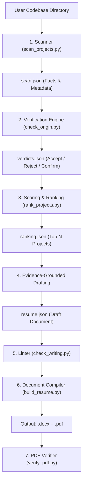

# Architecture & Pipeline Design

`resume-from-projects` implements a deterministic, multi-stage pipeline designed to eliminate hallucinations and extract verifiable achievements from software codebases.

---

## 1. Scanner (`scan_projects.py`)

- **Safety Invariant:** Read-only operations only. Employs `os.walk` with path depth limiting (`max_deep`).
- **Manifest Detection:** Identifies build descriptors across ecosystems:
  - Node.js (`package.json`)
  - Python (`pyproject.toml`, `setup.py`, `requirements.txt`)
  - Rust (`Cargo.toml`)
  - Go (`go.mod`)
  - JVM (`pom.xml`, `build.gradle`)
- **Git Metadata Extraction:** Reads commit authorship ratios, file history ownership, and remote configurations without altering repository state.

---

## 2. Origin & Authorship Verifier (`check_origin.py`)

Before any project is considered for the resume, it undergoes strict provenance analysis:
- **Fork Detection:** Checks for upstream remotes and forked commit roots.
- **Tutorial & Course Heuristics:** Matches README titles, commit messages, and dependencies against known educational patterns (Udemy, Coursera, freeCodeCamp, tutorial markers).
- **Author Attribution:** Requires that the user author a significant portion of commits and core files.

Projects receive one of three verdicts:
- `accept`: Proven original work with substantial user contribution.
- `reject`: Tutorial, course clone, or third-party fork.
- `confirm`: Ambiguous provenance (e.g. absent git history); requires explicit user confirmation.

---

## 3. Multi-Factor Ranker (`rank_projects.py`)

Surviving projects are scored along a weighted 100-point rubric:

$$\text{Score} = 0.30 \cdot S_{\text{real-world}} + 0.20 \cdot S_{\text{depth}} + 0.20 \cdot S_{\text{contrib}} + 0.15 \cdot S_{\text{quality}} + 0.10 \cdot S_{\text{recency}} + 0.05 \cdot S_{\text{relevance}}$$

- **Real-World Signals (30%):** Deployed infrastructure, production configuration, integration with payment/cloud providers, and live domains.
- **Technical Depth (20%):** Logarithmic scaling of lines of code, cross-language breadth, and architectural topology.
- **Contribution Share (20%):** User commit proportion and files touched.
- **Quality Evidence (15%):** Automated test suites (`pytest`, `jest`, `cargo test`), CI workflows, documentation depth.
- **Recency (10%):** Decay curve favoring actively maintained projects over dormant code.
- **Target Role Fit (5%):** Lexical and semantic match with the specified target title (e.g. backend, fullstack).

---

## 4. Linting & Writing Rules (`check_writing.py`)

- Enforces strict active voice without vague filler words ("spearheaded", "synergy", "cutting-edge").
- Rejects bullets containing ungrounded numbers.
- Checks typographic rules (no em dashes, no double hyphens, no title-cased bullet strings).

---

## 5. Document Compilation & Layout Verification (`build_resume.py` & `verify_pdf.py`)

- Generates semantic Word XML (`.docx`) with metric-compatible typography.
- Compiles pixel-perfect PDF via headless LibreOffice.
- Inspects compiled PDF using `pdfplumber` to verify strict single-page compliance, font thresholds (>= 9.5pt), and boundary margins.
